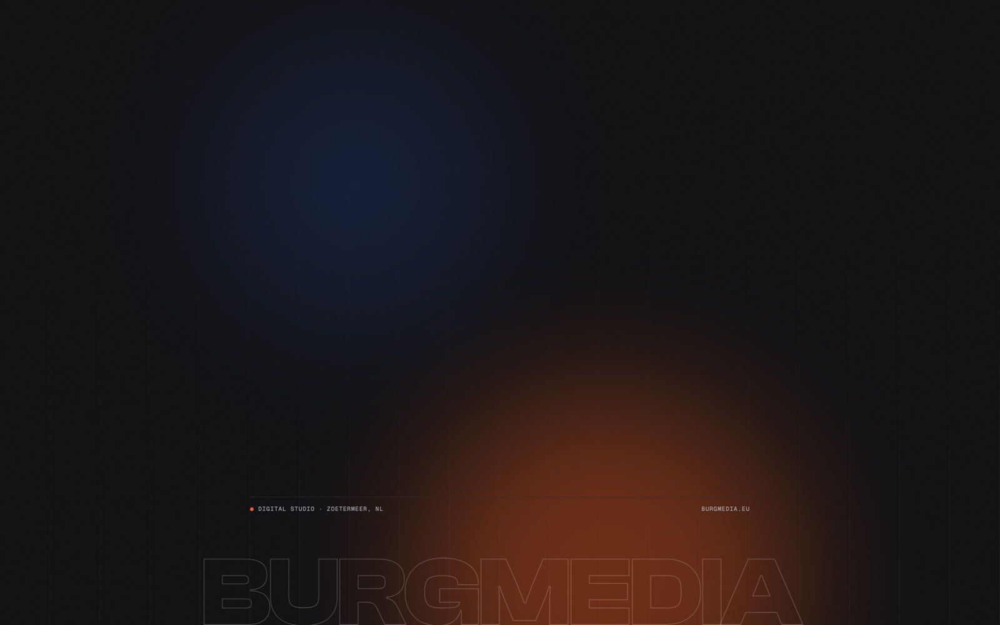

# Burg Theme

A dark Chrome theme in the Burg Media house style: ink black tabs and toolbar, signal orange accents and the BURGMEDIA wordmark on the new tab page.



## Features

- **Tab strip and toolbar** in deep ink black (`#0E0E10` and `#26252B`), text in soft cream (`#F4F3F0`).
- **Signal orange** (`#FF5C1A`) for the active tab title, links and headings on the new tab page.
- **New tab page** with a fine grid, an orange and a blue glow and the BURGMEDIA wordmark in outline letters, anchored to the bottom center.
- **Sharp on regular and high resolution screens**: separate 1x and 2x images (2560 × 1600).
- **A slightly lighter frame in incognito windows**, so you can tell them apart.
- **No code at all.** The theme is a `manifest.json` with colors and two images. There is no JavaScript in this extension.

Tip: turn on dark mode under Settings > Appearance, so Chrome's menus and side panels are dark too. To go back to the default theme: Settings > Appearance > **Reset to default**.

## Install from source (Developer mode)

The easiest way to install Burg Theme is the Chrome Web Store version, linked from the [Burg Theme page](https://burgmedia.eu/shop/burg-theme). That version updates automatically. If you prefer to install it from this repository, it takes a minute:

1. **Download the code.** Click the green **Code** button on this page and choose **Download ZIP**, or download the zip from [Releases](../../releases). Unzip it.
2. **Open the extensions page.** Type `chrome://extensions` in the address bar and press Enter.
3. **Turn on Developer mode.** Use the **Developer mode** switch in the top right corner.
4. **Load the theme.** Click **Load unpacked** and choose the unzipped folder (the folder that contains `manifest.json`). Chrome applies the theme right away and replaces your current one.
5. **Pinning is not needed.** A theme has no toolbar icon.

Good to know:

- **Other browsers.** Chrome themes also work in other Chromium based browsers that support them, such as Microsoft Edge (`edge://extensions`) and Brave (`brave://extensions`). The steps are the same; the Developer mode switch may be in a different place on the page. How much of the theme is applied differs per browser.
- **No automatic updates.** A theme loaded this way does not update itself. To update, download the new version, replace the folder and click the **Reload** icon on the Burg Theme card in `chrome://extensions`.
- **Developer mode notice.** Chrome may remind you that extensions in developer mode are running. That is normal for extensions you load yourself.

## Check it yourself with your AI agent

The theme is a single `manifest.json` plus images, so you don't have to take our word for anything. Point your own AI agent (Claude Code, Cursor, Copilot, ChatGPT) at this folder and let it check.

```text
Audit this Chrome extension for security and privacy before I install it.
1. List every permission in manifest.json and whether the code actually needs it.
2. Find every network request (fetch, XMLHttpRequest, WebSocket, sendBeacon, image or
   script URLs, remote code) and tell me where data goes.
3. Check for remote code execution: eval, new Function, remotely loaded scripts.
4. Check what is stored (chrome.storage, IndexedDB, cookies) and whether anything
   leaves my browser.
5. Check content scripts: which sites they run on and what they read from pages.
6. Give a verdict: safe to install or not, with file and line references.
```

The fastest manual check, from inside the folder:

```sh
grep -rn "fetch\|XMLHttpRequest\|http" .
```

Besides this README you will find the `homepage_url` in `manifest.json` and an SVG namespace inside `bron/ntp.html`, the source file of the background image that is not part of the installed theme.

## Privacy and security

- **No permissions, no host permissions, no scripts.** The theme cannot read or change any website, and there is no JavaScript that could run.
- **No network requests.** Nothing is loaded from the internet; the background images are in `images/`.
- **Nothing is stored and nothing is collected.** No account, no analytics, no tracking, no ads.
- **No welcome page.** Unlike our other extensions, a theme cannot open pages, so nothing on burgmedia.eu is visited when you install or remove it.

Found a security problem? See [SECURITY.md](SECURITY.md).

## Why is this free?

Burg Media is a small web studio in the Netherlands. We build these tools for our own work and give them away: no ads, no premium tier, no data collection. If they are useful to you, that is the best introduction to what we do. We build websites, web apps and custom software: [burgmedia.eu](https://burgmedia.eu)

## Permissions explained

Burg Theme asks for **no permissions** and has no `host_permissions` and no content scripts. `manifest.json` only contains the `theme` section (colors, the new tab image and its alignment), the icons and the name and description in English and Dutch (`_locales/`).

## Change the background

`bron/ntp.html` is the source of `images/ntp.png` and `images/ntp@2x.png`. After a change, run `bron/render.sh` (macOS, uses headless Google Chrome) and reload the theme. Chrome places the image at the bottom center and does not scale it; on narrower screens the sides are cut off, so keep everything that must stay visible within the middle ~1300 px.

The wordmark uses Clash Display, which is not included in this repository because its license does not allow redistribution. See [`bron/fonts/README.md`](bron/fonts/README.md) for where to get it. The finished images already contain the wordmark.

## Alternatives

Looking for an alternative to Google's Just Black theme or another dark Chrome theme? Burg Theme is a calm, dark theme with a warm orange accent instead of plain gray, a new tab page with some atmosphere, and nothing else: no permissions, no scripts and no new tab extension that wants access to your browsing.

## License

[MIT](LICENSE), Copyright (c) 2026 Burg Media. The Geist fonts in `bron/fonts/` are licensed under the SIL Open Font License 1.1, see [NOTICE.md](NOTICE.md).

Made by [Burg Media](https://burgmedia.eu).
